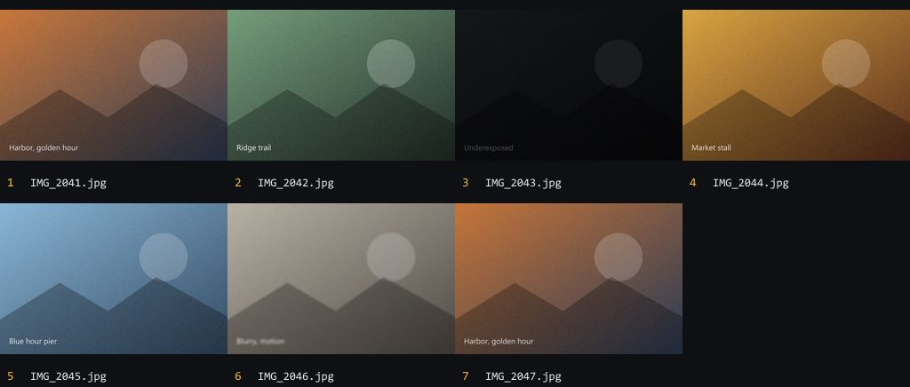
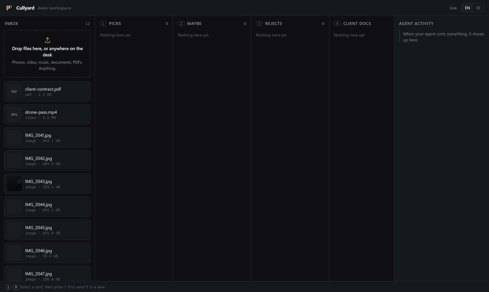
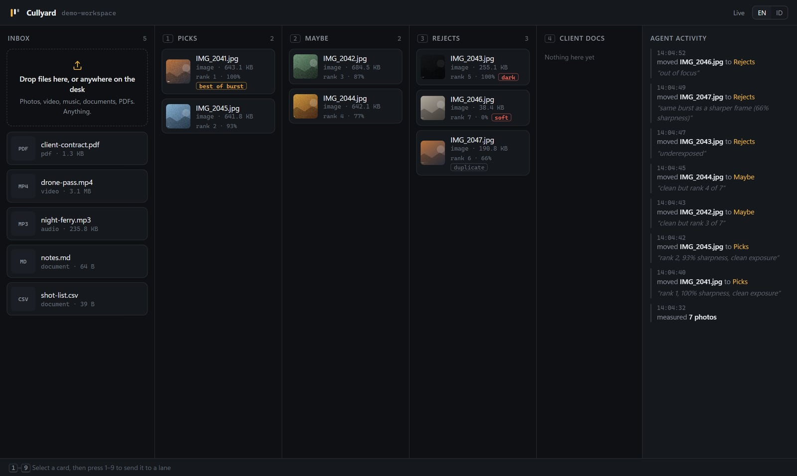
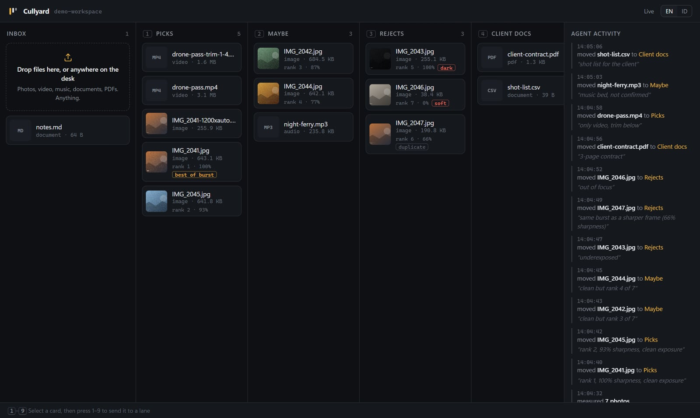
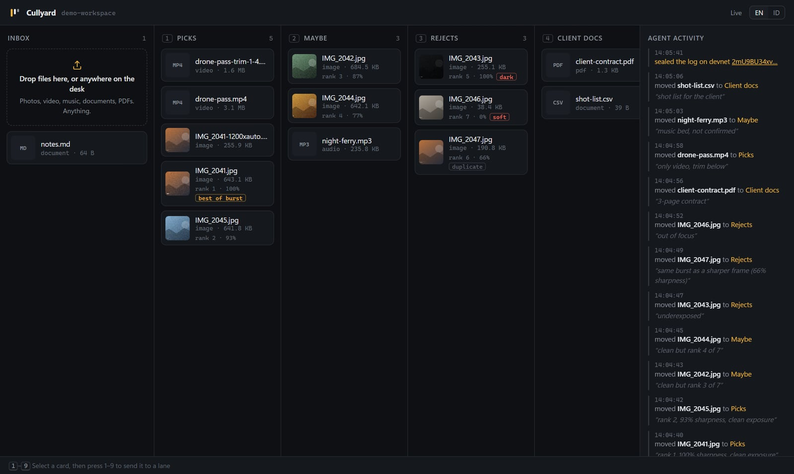
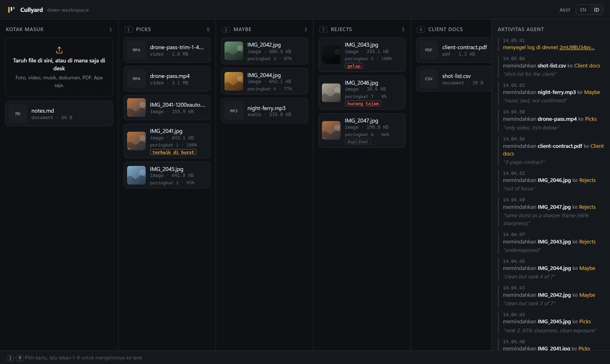
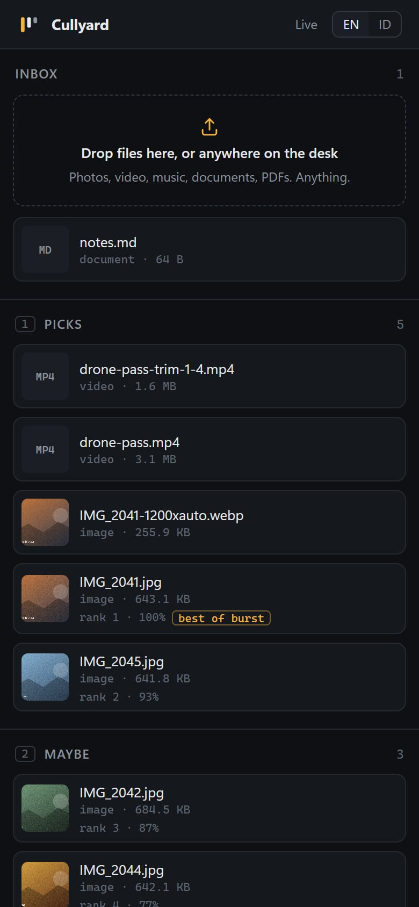

# Cullyard 0.2.0 build report

24 October 2026. The same report, with the video inline, is at `web/report.html`.

## Summary

| Area | Result |
| --- | --- |
| MCP tools | 14 tools over stdio |
| Photo checks | In the recorded run, all three planted defects were found by measurement: one soft frame, one dark frame, one burst duplicate |
| File kinds | 10 kinds; unknown extensions are listed as `other`, never refused |
| Automated tests | 18 of 18 pass with `npm test` on Windows 11, Node 24 ([test-output.txt](test-output.txt)) |
| Recorded agent run | 11 of 12 files sorted into 4 lanes with a reason each, 1 WebP copy, 1 three-second trim, sealed and verified ([agent-transcript.txt](agent-transcript.txt)) |
| Devnet seal | Memo read back from the chain on 24 October 2026, equal to the local SHA-256 |
| Languages | English by default, Indonesian on the desk and the site |

## Photo checks

- `contact_sheet` and `preview_image` return MCP image results, so a vision model looks at the photos.
- Focus: variance of the Laplacian on a contrast-stretched greyscale copy, per tile on a 4×4 grid; the sharpest tile counts. `soft` is under 40% of the set's median.
- Exposure: mean brightness and clipped shadows or highlights give `dark` and `bright`.
- Bursts: a 64-bit difference hash and a 3×3 colour print must both match. The sharpest frame is kept; the rest are `duplicate`.

Three mistakes were found and fixed during the build, each now covered by a test: every sample was grouped into one burst because the hash ignores colour; a dark frame also read as soft; and the dark frame's sensor noise ranked it sharpest. Rank now puts clean frames first, and percentages are measured against the sharpest well-exposed frame.

## Devnet seal

- Signature: [2mU9BU34xv2kxLfku9eVrT8R3bCEWgBag7Hm8cwuYvbJeMPZzDte4QG1t5fj5Qc5oGcqpx9nexFmNNk4SSK88m6p](https://explorer.solana.com/tx/2mU9BU34xv2kxLfku9eVrT8R3bCEWgBag7Hm8cwuYvbJeMPZzDte4QG1t5fj5Qc5oGcqpx9nexFmNNk4SSK88m6p?cluster=devnet)
- Memo: `cullyard:v1 log=1f3b7978f414a367fa9de4f5d709b107afac58d07b6768bb70e0c32d7fc5434c entries=12`
- Slot 514512080, 24 Oct 2026 06:05:39 UTC, no error
- Signer: `AsrL4uc9Ct7rhCASJXMhCtAX3k76RgkSsoe3pZFsBdyM`

## Screenshots

The desk header shows only the workspace folder name, so no local path appears.

| | |
| --- | --- |
|  1. Twelve files in Inbox |  2. Photos sorted with rank, flags and reasons |
|  3. Sorted, with the agent's Client docs lane |  4. Sealed, feed links to the transaction |
|  5. Same state in Indonesian |  6. Phone width |

## Media

- Walkthrough of the recorded run: `web/media/walkthrough.mp4` (80 s, 1440 × 860; captured at about 1 fps and shown at real speed)
- Product film: `video/cullyard-marketing.mp4` (51 s, 1920 × 1080, no sound). It was made from the 0.1.0 run and does not show the photo checks.
- Pitch deck: `pitch/cullyard-pitch.pdf`, slides as PNG in `pitch/slides/`

## Limits

- Photo thresholds were tuned on generated test images, not on a real shoot yet. Flags are hints.
- A shallow-focus portrait or a low-key shot can be a keeper with "bad" numbers.
- Image results work in Claude Code; Antigravity was not tested.
- Trim uses stream copy, so cuts land on the nearest keyframe.
- Some RAW formats show only kind and size, depending on the bundled decoder.
- Seals use devnet only and are not a legal record.
- Only Windows 11 was tested for this release.
